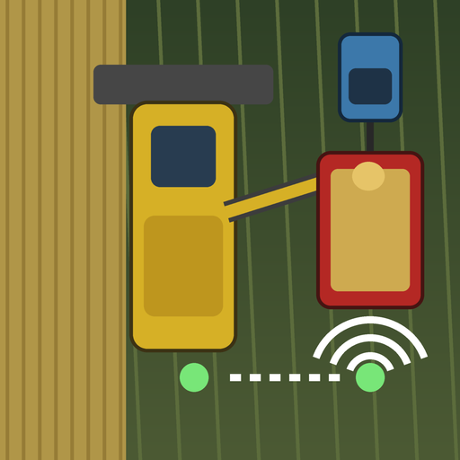
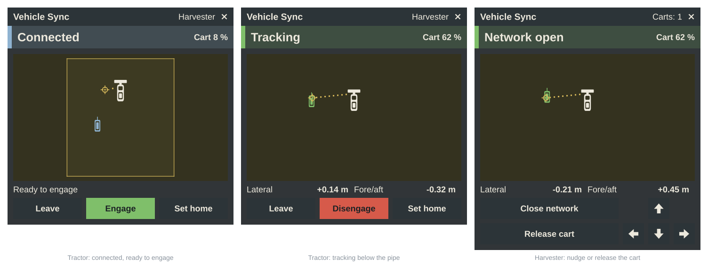

<p align="center">
  
</p>

<h1 align="center">Vehicle Sync for Farming Simulator 25</h1>

<p align="center">
  <b>The harvester steers the grain cart. Unload on the go, in multiplayer.</b><br>
  Leader/follower machine synchronisation, modelled on the real systems used on modern farms.
</p>

<p align="center">
  <a href="https://github.com/CSchoch/FS25_VehicleSync/releases/latest"></a>
  <a href="https://github.com/CSchoch/FS25_VehicleSync/releases"></a>
  
  
  
  <a href="LICENSE"></a>
</p>

<p align="center">
  <a href="#installation">Installation</a> ·
  <a href="#how-it-works">How it works</a> ·
  <a href="#controls">Controls</a> ·
  <a href="#server-settings">Server settings</a> ·
  <a href="#development">Development</a> ·
  <a href="#deutsch">Deutsch</a>
</p>

---

One player drives the combine harvester, another one sits in the tractor with the grain cart. When
the tractor driver engages the sync, the harvester takes over the tractor's **steering and speed**
and keeps the cart right below the pipe outlet. The harvester driver can nudge the cart to fill it
evenly. The tractor driver can take over at any moment.

<p align="center">
  
</p>

## Features

- **Join, engage, track.** The tractor joins the harvester's sync network, drives into the
  operational zone and engages. The sync goes from *Acquiring* to *Tracking* once the cart is in position.
- **Nudging.** The harvester driver moves the cart forward, back, left or right in 25 cm steps, or releases it.
- **Instant takeover.** Steering, the pedals or cruise control give control back to the tractor
  driver immediately. After a steering takeover the tractor keeps the harvester's speed, so the
  cart does not brake hard below the pipe.
- **Safe aborts.** The sync ends after a 5 s countdown when the harvester stops, reverses, turns
  sharply or drives faster than 16 km/h, or when the cart is full. A short stop does not end it.
- **Home point.** By default the cart sits below the pipe outlet. The tractor driver can store
  another position, and it is saved with the savegame.
- **In-cab terminal.** One window shows the state, the cart fill level and a top view of the
  harvester, the operational zone, the home point and the cart. It works with the mouse and can
  be moved by dragging.
- **Multiplayer first.** Everything is calculated on the server and synced to every player,
  including players who join a running game.
- **Driver assist, not an AI helper.** A player has to sit in the tractor, like in the real system.
  No helper wages, and no AI job slot is used.

## Installation

1. Download `FS25_VehicleSync.zip` from the [latest release](https://github.com/CSchoch/FS25_VehicleSync/releases/latest).
2. Put the zip **without unpacking it** into
   `Documents\My Games\FarmingSimulator2025\mods`.
3. Activate *Vehicle Sync* when you start or load a savegame.

In multiplayer, the server and every player need the same version.

## How it works

| Step | Who | What |
| --- | --- | --- |
| 1 | Harvester | Open the terminal (<kbd>Left Alt</kbd> + <kbd>Y</kbd>) and click **Open network**. |
| 2 | Tractor | Drive within 60 m of the harvester and click **Join network**. The terminal shows the nearest open network and how far away it is. |
| 3 | Tractor | Drive into the operational zone beside or behind the harvester, then click **Engage** while the harvester is moving. |
| 4 | Both | The tractor steers and matches its speed on its own: *Connected* → *Acquiring* → *Tracking*. |
| 5 | Harvester | Use the arrow buttons to nudge the cart, or click **Release cart**. |

The sync ends **immediately** when the tractor driver steers, uses the pedals, switches on cruise
control, leaves the tractor or switches off the engine. It ends **after 5 seconds** when one of
these lasts that long (the terminal and a blinking warning count down):

- the harvester stops, reverses or drives faster than 16 km/h,
- the harvester turns sharply (for example at the headland), or the cart is too far from the home point,
- the grain cart is full.

The tractor stays connected to the network, so one click engages the sync again.

Only vehicles of the same farm, or of farms with access to each other, can sync. Only the player
sitting in a vehicle can operate it.

## Controls

| Input | Action |
| --- | --- |
| <kbd>Left Alt</kbd> + <kbd>Y</kbd> | Open the terminal with the mouse cursor. While it is open, this brings the cursor back. |
| Right click | Hide the cursor to look around. The terminal stays open. |
| Drag the title bar | Move the terminal. The position is kept. |
| **×** in the title bar | Close the terminal. |

All other functions have no default key, so they don't clash with other mods: open or close the
network, join or leave, engage or disengage, set the home point, the four nudge directions, and
release. You can bind them under **Settings → Controls → Vehicle Sync**.

## Server settings

The server admin changes these in the console. They are saved in `vehicleSync.xml` in the savegame.

```
vsSettings                     list all settings
vsSet maxSyncSpeed 20          change one
```

| Setting | Default | Meaning |
| --- | --- | --- |
| `maxSyncSpeed` | 16 | km/h, the highest harvester speed the sync accepts |
| `radioRange` | 500 | m, range of the sync network |
| `connectRange` | 60 | m, maximum distance for joining a network |
| `maxLeaderCurvature` | 0.5 | °/m, a tighter harvester turn counts as turning |
| `abortDelay` | 5000 | ms, how long a machine fault may last before the sync ends |
| `nudgeStepLateral` | 0.25 | m per sideways nudge |
| `nudgeStepAlong` | 0.25 | m per forward or backward nudge |
| `disengageOnCartFull` | true | end the sync when the cart is full |
| `keepSpeedOnSteering` | true | after a steering takeover, keep the harvester's speed on cruise control |

## Compatibility

- Any driveable, enterable, motorised vehicle can take part, including modded ones. Normally the
  leader is a harvester with a pipe and the follower is a tractor pulling a grain cart. The home
  point follows the pipe outlet, and the cart's fill level is shown in the terminal.
- The terminal reacts to the mouse cursor even when another mod shows it (for example Courseplay or AutoDrive).
- Found a problem? [Open an issue](https://github.com/CSchoch/FS25_VehicleSync/issues/new/choose)
  and attach your `log.txt` (`Documents\My Games\FarmingSimulator2025\log.txt`).

## Development

Plain Lua 5.1 with no dependencies. The engine is mocked, so every rule can be tested without the game.

```powershell
# tests with line coverage (fails below 90 %)
& "C:\Program Files (x86)\Lua\5.1\lua.exe" tests\run_tests.lua --coverage

# release zip (runs the tests first) -> dist\FS25_VehicleSync.zip
.\create_release.bat
```

| File | Role |
| --- | --- |
| [`src/VehicleSyncMath.lua`](src/VehicleSyncMath.lua) | 2D geometry |
| [`src/VehicleSyncController.lua`](src/VehicleSyncController.lua) | State machine, operational zone, home point, pure-pursuit steering and speed law (no engine calls) |
| [`src/VehicleSyncSettings.lua`](src/VehicleSyncSettings.lua) | Server settings and console commands |
| [`src/network/`](src/network/) | Client → server requests, server → client state |
| [`src/VehicleSyncSpec.lua`](src/VehicleSyncSpec.lua) | Vehicle specialization: server rules, driving override, streams, input |
| [`src/hud/`](src/hud/) | In-cab terminal: a pure layout model and the drawing glue |
| [`src/VehicleSync.lua`](src/VehicleSync.lua) | Bootstrap |

The images are generated: `python tools/make_icon.py` (mod icon), `python tools/make_hud_icons.py`
(terminal atlas), `python tools/make_social_preview.py` (GitHub card) and
`lua tools/render_hud_preview.lua` (the terminal preview above, drawn from the real layout code).

## License

[MIT](LICENSE) © Christian Schoch

## Deutsch

**Fahrzeug Synchronisation** lässt einen Drescher Lenkung und Geschwindigkeit eines Traktors mit
Überladewagen übernehmen, damit während der Fahrt abgetankt werden kann. Der Mod ist für den
Mehrspielermodus gemacht: einer fährt den Drescher, ein anderer sitzt im Traktor.

1. Drescher: Terminal mit <kbd>Linke Alt</kbd> + <kbd>Y</kbd> öffnen, **Netzwerk öffnen**.
2. Traktor: in die Nähe fahren, **Netzwerk beitreten**.
3. Traktor: in den Arbeitsbereich neben oder hinter dem Drescher fahren, **Aktivieren**.
4. Der Traktor fährt den Wagen unter das Rohrende. Der Drescherfahrer kann ihn mit den Pfeilen versetzen.

Lenken, Pedale oder Tempomat geben die Kontrolle sofort zurück. Hält der Drescher an, wendet er,
fährt er zu schnell oder ist der Wagen voll, endet die Synchronisation nach 5 Sekunden. Die
vollständige Anleitung steht in der Modbeschreibung im Spiel.

**Installation:** `FS25_VehicleSync.zip` aus den [Releases](https://github.com/CSchoch/FS25_VehicleSync/releases/latest)
ungeöffnet in `Dokumente\My Games\FarmingSimulator2025\mods` legen.
